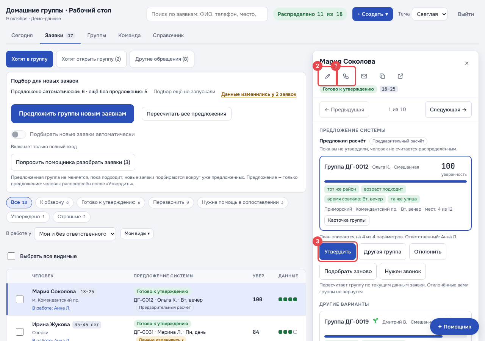
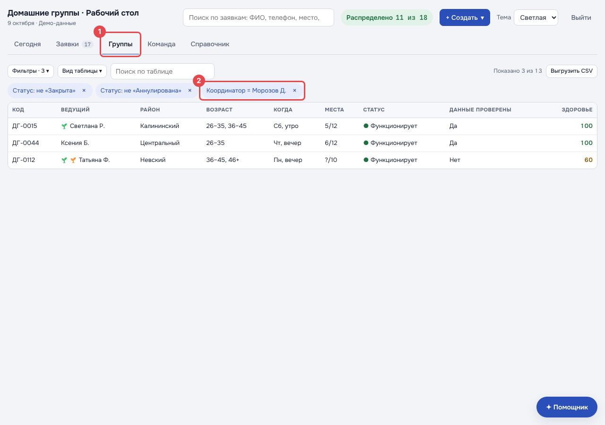
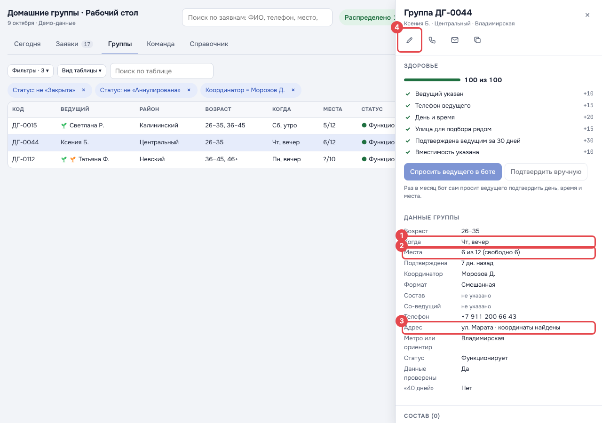
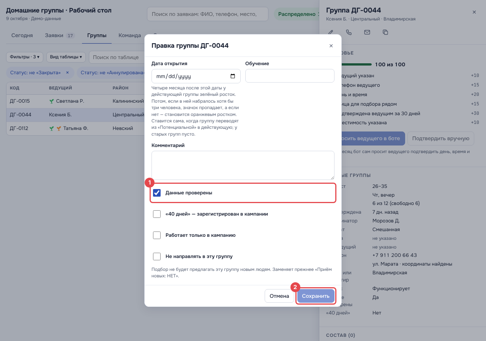
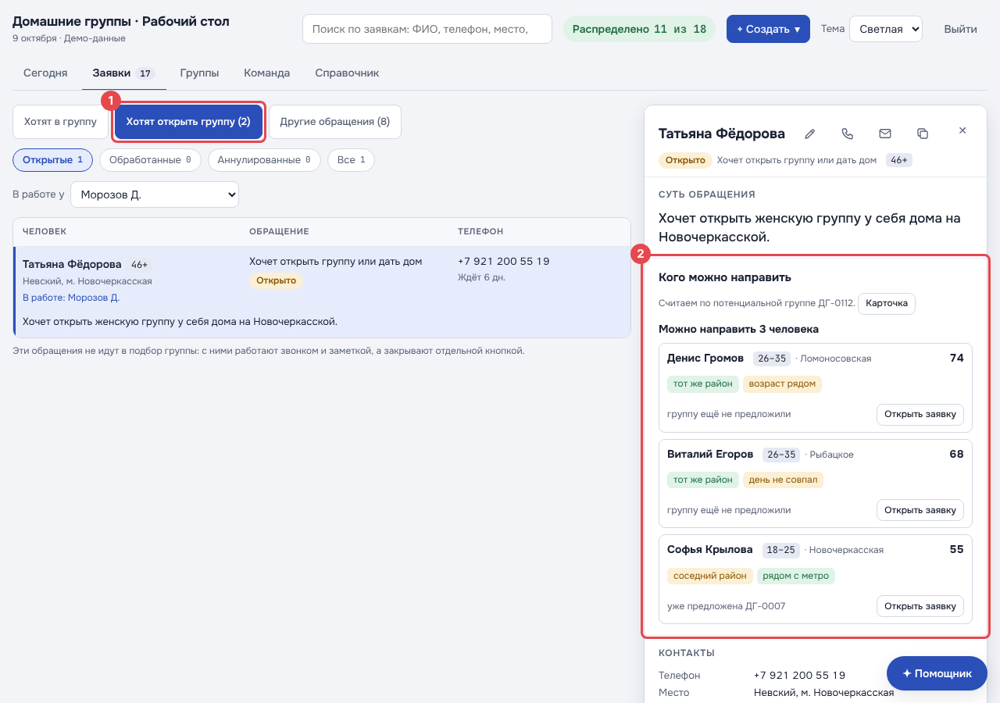

# Памятка для команды

На картинках красная рамка с цифрой показывает, куда нажать. Цифра на картинке — это номер пункта под ней.

- **Распределитель** звонит людям, которые хотят в группу, и подбирает им группу. Читайте разделы 1 и 2.
- **Координатор** звонит в свои группы и проверяет их. Читайте разделы 1 и 3.

## 1. Войти

Откройте ссылку на сайт, которую вам прислали.

1. Впишите **логин** — его вам дали вместе с паролем.
2. Впишите **пароль**.
3. Нажмите **«Войти»**.

Забыли пароль — попросите того, кто его выдал, сделать новый.

## 2. Распределитель: заявки

1. Откройте вкладку **«Заявки»**.
2. Здесь сразу видны **ваши заявки и те, что ещё никто не взял**. Ничего настраивать не нужно.
3. Закончили — нажмите **«Выйти»** справа вверху.

Нажмите на человека — справа откроется его заявка.

1. **Позвоните** человеку. Спросите, какая группа ему подойдёт: район, день, время.
2. Чего-то не хватает или ошибка — нажмите **карандаш** и допишите.
3. Группа подходит — нажмите **«Утвердить»**.

## 3. Координатор: свои группы

1. Откройте вкладку **«Группы»**. Здесь сразу видны **только ваши группы**.

Позвоните в **каждую** группу. Нажмите на строку группы — справа откроется её карточка.

Спросите у ведущего и сверьте с карточкой:

- группа **собирается**?
- **сколько людей** и кто они;
- **когда** собирается (1);
- **сколько мест** всего и сколько свободно (2);
- **адрес** (3).

Если группа **ещё не открылась** — спросите, точно ли она откроется, и всё то же самое.

4. Нажмите **карандаш**.

Исправьте, что изменилось.

1. Поставьте галочку **«Данные проверены»**.
2. Нажмите **«Сохранить»**.

### Кто хочет открыть группу

1. В **«Заявках»** нажмите **«Хотят открыть группу»**. Здесь ваши люди, которые хотят открыть группу.
2. Нажмите на человека. Справа будет **«Кого можно направить»** — сколько людей можно отправить в эту группу.

Так при звонке можно сказать: «Можем направить к вам троих». Или: «Пока людей нет».

---

Для разработчиков: картинки пересоздаёт `npm run shots:guide` в `web/home-groups` (экраны `guide-*` в
`scripts/shots.mjs`; вход «по личному паролю» в демо — `localStorage['hg.demo.person']` и `hg.demo.role`, см.
`src/fixtures/index.ts`).
