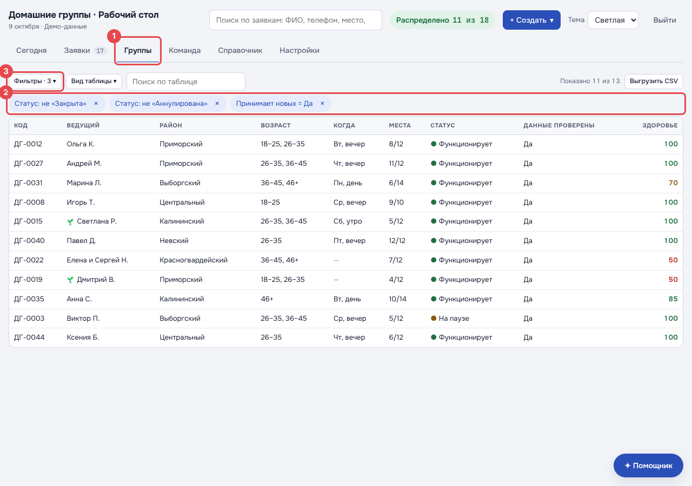
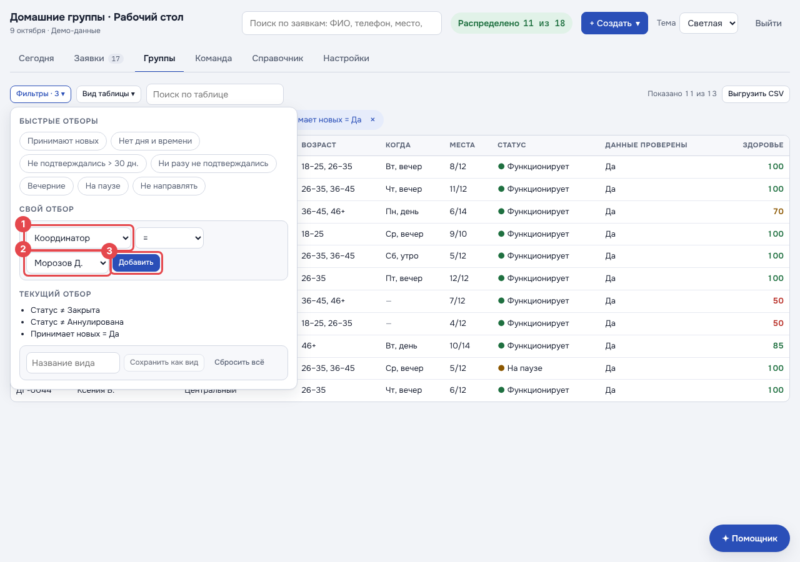
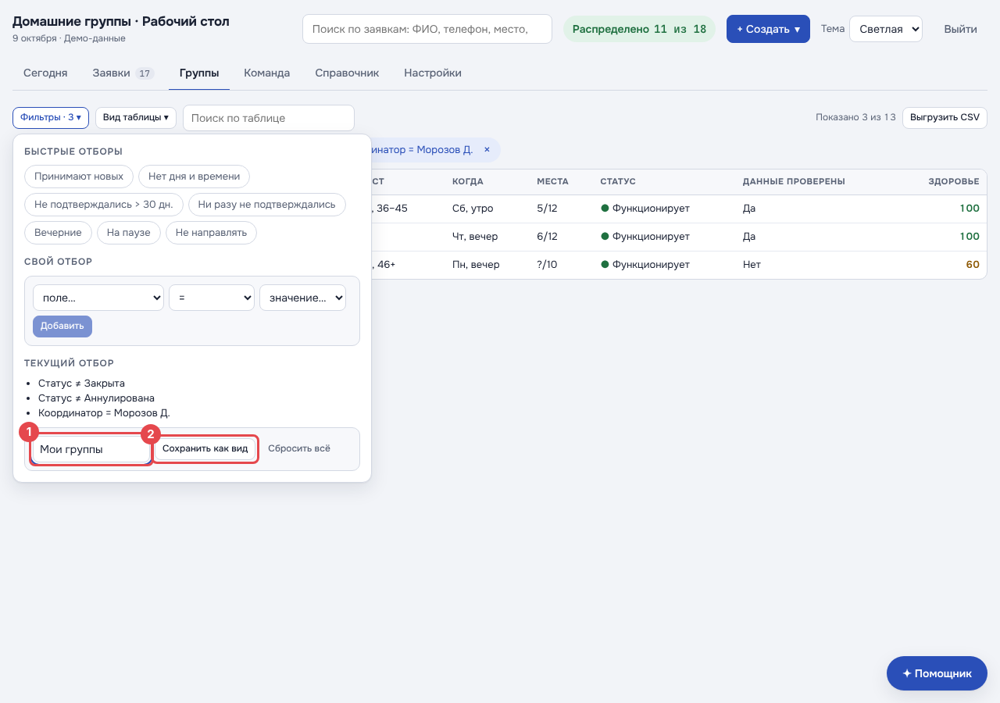
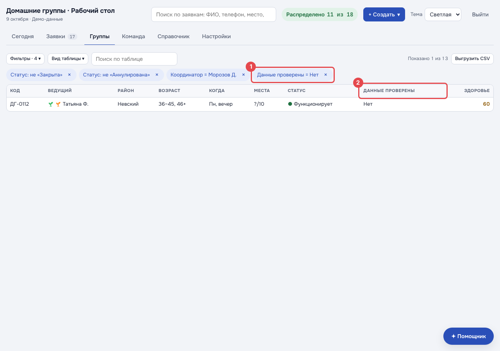
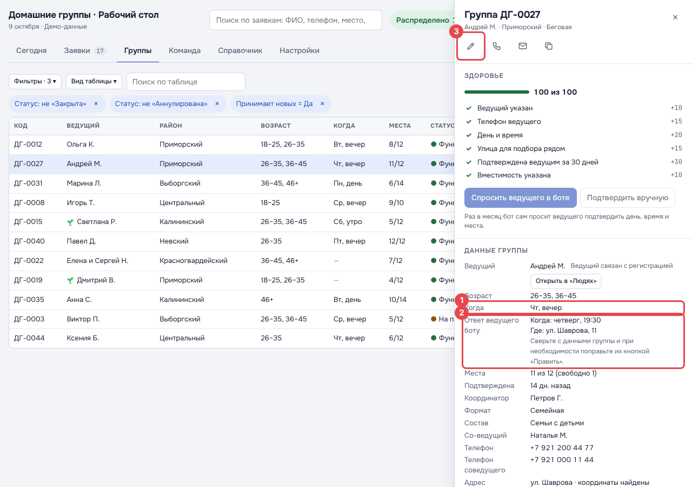
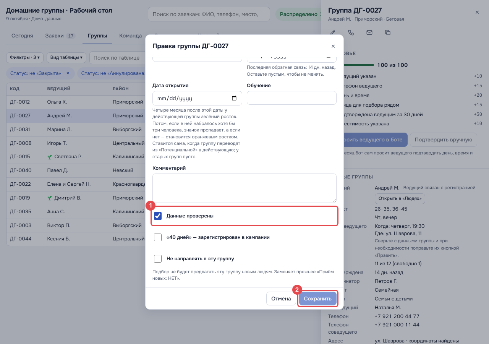
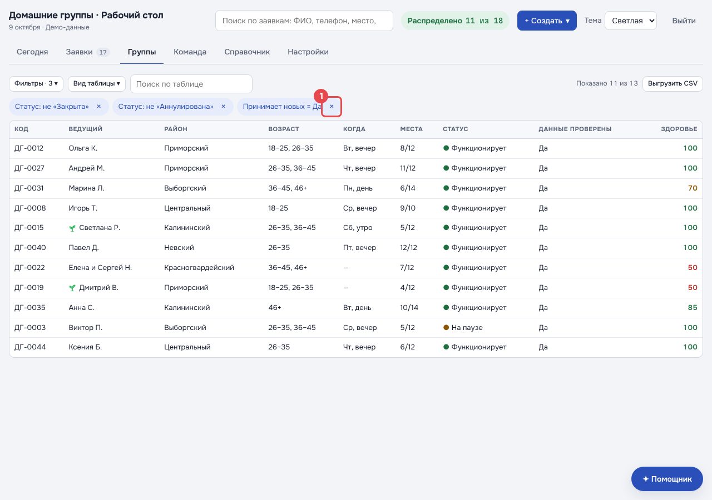

# Как найти свои группы и проверить их данные

Инструкция для координаторов домашних групп. На снимках красная рамка с номером показывает, куда нажать;
номер в рамке совпадает с номером пункта под снимком. Снимки сделаны на демо-данных: имена, группы и числа
у вас будут другие.

## 1. Откройте вкладку «Группы»

1. Вверху нажмите вкладку **«Группы»**. Та же таблица есть в «Справочник → Группы».
2. Над таблицей стоят отборы по умолчанию — серо-синие «чипы»: не закрытые, не аннулированные и
   «Принимает новых = Да». Последний показывает только группы, куда можно направлять людей: без отметки
   «Не направлять» и не «Служение» и не «Приватная (Закрытая)».
3. Свои отборы добавляются кнопкой **«Фильтры»**.

## 2. Оставьте только свои группы

В окне «Фильтры», в блоке «Свой отбор»:

1. В первом списке выберите поле **«Координатор»** (условие «=» уже стоит).
2. В списке значений выберите **своё имя**.
3. Нажмите **«Добавить»**.

1. Появился чип **«Координатор = …»** с вашим именем. Нажатие на «×» в чипе убирает отбор.
2. Справа видно, сколько групп осталось: «Показано 3 из 13».

Если своих групп меньше, чем вы ожидали, снимите чип «Принимает новых = Да» (пункт 6): он прячет группы
с «Не направлять», служения и закрытые группы.

## 3. Сохраните отбор, чтобы не собирать его каждый раз

1. Снова откройте «Фильтры» и внизу впишите название, например **«Мои группы»**.
2. Нажмите **«Сохранить как вид»**.

Сохранённый вид появится в окне «Фильтры» кнопкой: одно нажатие — и таблица снова показывает только ваши
группы. Вид запоминается в этом браузере. На другом компьютере или телефоне сохраните его ещё раз.

## 4. Найдите группы, которые ещё не проверены

Добавьте к своему отбору ещё одно условие тем же способом, что в пункте 2: поле **«Данные проверены»**,
значение **«Нет»**.

1. Появился чип **«Данные проверены = Нет»**: в таблице остались только ваши непроверенные группы.
2. Столбец **«Данные проверены»** в таблице показывает «Да» или «Нет» у каждой группы.

## 5. Проверьте группу и отметьте «Данные проверены»

Нажмите на строку группы — справа откроется её карточка.

1. Сверьте с ведущим данные группы: **«Когда»**, адрес, места, возраст, телефоны.
2. Строка **«Ответ ведущего боту»** появляется, если ведущий сам ответил боту, когда и где собирается
   группа. В группу этот ответ сам не переносится: сверьте его с «Когда» и адресом.
3. Чтобы поправить данные, нажмите **карандаш** («Править») под названием группы.

1. Исправьте, что нужно, и поставьте галочку **«Данные проверены»**.
2. Нажмите **«Сохранить»**. Группа пропадёт из отбора «Данные проверены = Нет» — значит, с ней всё.

Если в группу больше нельзя направлять людей, в той же форме поставьте галочку **«Не направлять в эту
группу»**. Она заменяет прежнее поле «Приём новых: НЕТ».

## 6. Как увидеть все группы

1. Нажмите **«×»** на чипе, чтобы снять этот отбор. Так же снимаются «не Закрыта» и «не Аннулирована».

Снятый отбор не возвращается сам, пока вы на этой странице. При следующем открытии вкладки отборы по умолчанию
встанут снова. «Сбросить всё» в окне «Фильтры» убирает все отборы сразу.

---

Снимки для этой инструкции пересоздаются командой `npm run shots:guide` в `web/home-groups`: она снимает
демо-данные и сама рисует рамки (экраны `guide-*` в `web/home-groups/scripts/shots.mjs`).
