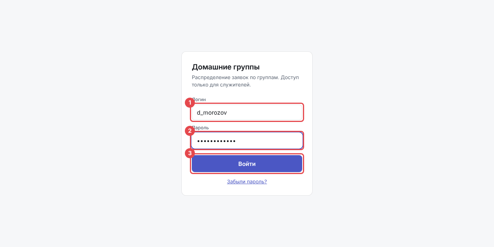
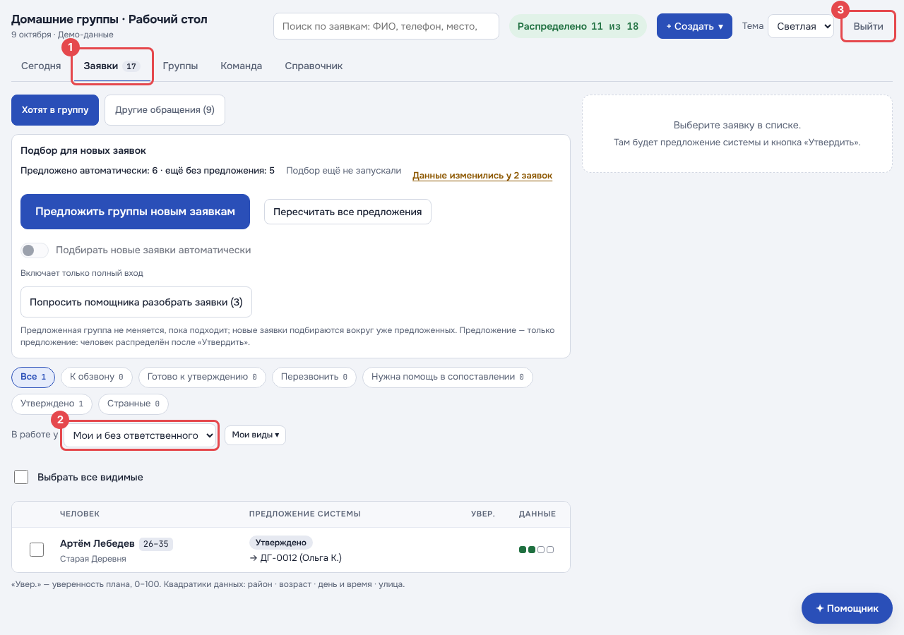
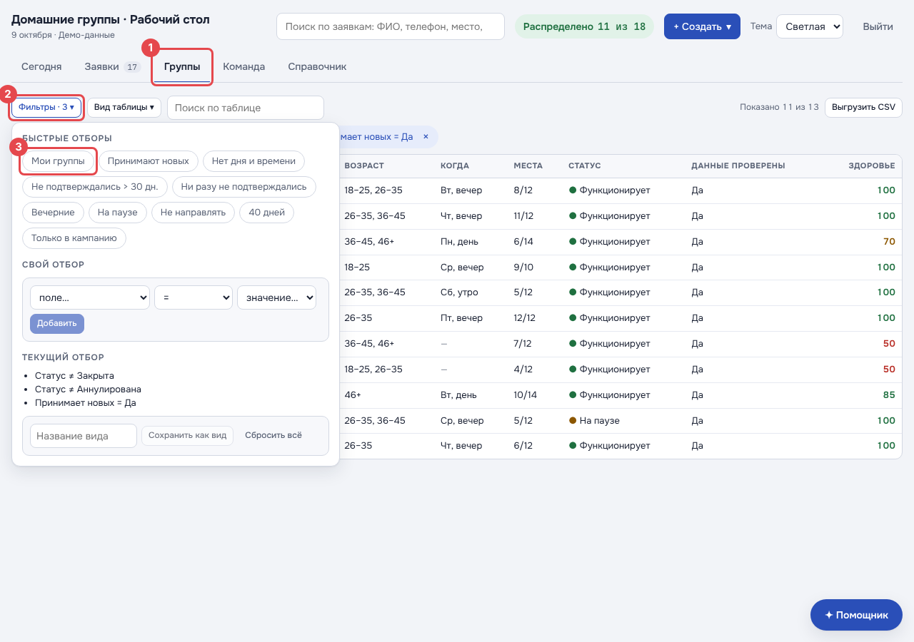
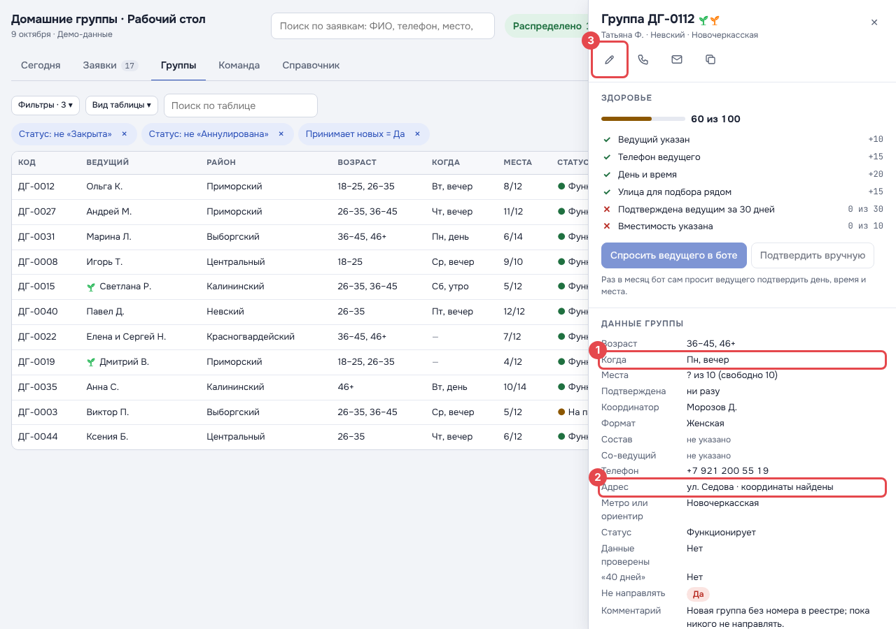
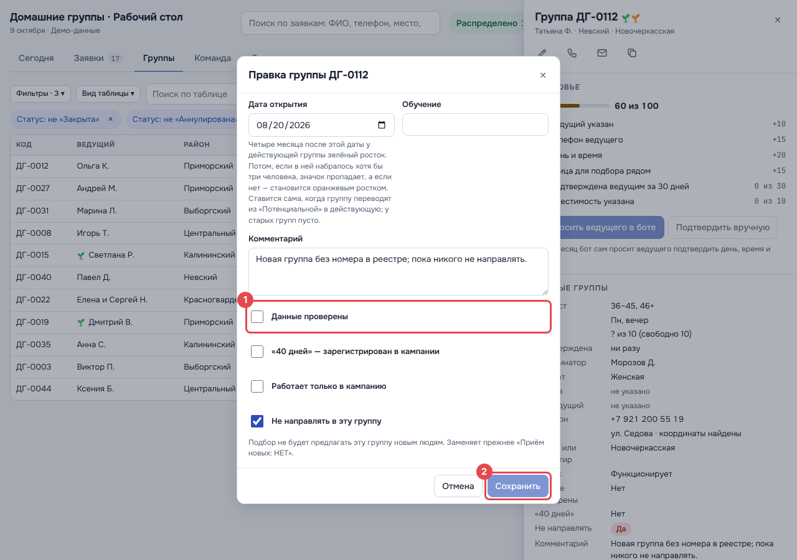

# Памятка координатора

На картинках красная рамка с цифрой показывает, куда нажать. Цифра на картинке — это номер пункта под ней.

## 1. Войти

Откройте ссылку на сайт, которую вам прислали.

1. Впишите **логин** — его вам дали вместе с паролем.
2. Впишите **пароль**.
3. Нажмите **«Войти»**.

Забыли пароль — попросите того, кто его выдал, сделать новый. Ссылку «Забыли пароль?» нажимать не нужно.

## 2. Ваши заявки

1. Откройте вкладку **«Заявки»**.
2. Здесь сразу видны **ваши заявки и те, что ещё никто не взял**. Ничего настраивать не нужно.
3. Закончили — нажмите **«Выйти»** справа вверху.

## 3. Ваши группы

1. Откройте вкладку **«Группы»**.
2. Нажмите **«Фильтры»**.
3. Нажмите **«Мои группы»**. В таблице останутся только ваши группы.

## 4. Проверить группу

Нажмите на строку группы — справа откроется её карточка.

1. Проверьте вместе с ведущим, **когда** собирается группа.
2. Проверьте **адрес**.
3. Если что-то не так или всё верно — нажмите **карандаш**.

1. Исправьте, что нужно, и поставьте галочку **«Данные проверены»**.
2. Нажмите **«Сохранить»**.

Готово. Так проверьте все свои группы.

---

Для разработчиков: картинки пересоздаёт `npm run shots:guide` в `web/home-groups` (экраны `guide-*` в
`scripts/shots.mjs`, вход «по личному паролю» в демо — `localStorage['hg.demo.person']`).
