# Инструкция для распределителя

Для печати: [Инструкция-распределителя.pdf](Инструкция-распределителя.pdf).

Распределитель звонит людям, которые хотят в домашнюю группу, и подбирает им группу. Эта инструкция — только про
вашу работу: всё остальное на сайте можно не трогать.

**Как читать картинки.** Красный кружок с цифрой и стрелка показывают, куда нажать. Цифры — это порядок: сначала 1,
потом 2. Под картинкой те же пункты словами.

## Оглавление

1. [Основной путь: от заявки до «Утвердить»](#1-основной-путь-от-заявки-до-утвердить)
2. [Как посмотреть данные группы](#2-как-посмотреть-данные-группы)
3. [Группа не подходит человеку](#3-группа-не-подходит-человеку)
4. [Не дозвонился](#4-не-дозвонился)
5. [Человек отказался или уже нашёл группу](#5-человек-отказался-или-уже-нашёл-группу)
6. [Исправить данные человека](#6-исправить-данные-человека)
7. [Группы на карте](#7-группы-на-карте)
8. [Какие группы есть в районе](#8-какие-группы-есть-в-районе)
9. [Найти человека по фамилии или телефону](#9-найти-человека-по-фамилии-или-телефону)
10. [Что значат кнопки над списком](#10-что-значат-кнопки-над-списком)
11. [Частые вопросы](#11-частые-вопросы)

---

## 1. Основной путь: от заявки до «Утвердить»

Это то, что вы делаете каждый день. Пять шагов на одного человека.

### Шаг 1. Откройте заявки и выберите человека

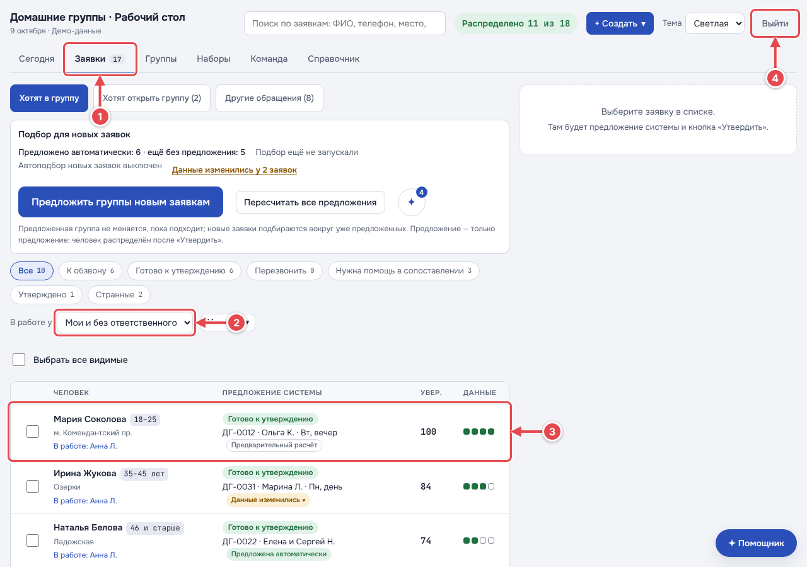

1. Откройте вкладку **«Заявки»**.
2. Здесь уже стоит **«Мои и без ответственного»**: видны ваши люди и те, кого ещё никто не взял. Ничего менять не
   нужно.
3. Нажмите на **человека** в списке — справа откроется его заявка.
4. Закончили работу — нажмите **«Выйти»** справа вверху.

### Шаг 2. Возьмите человека себе

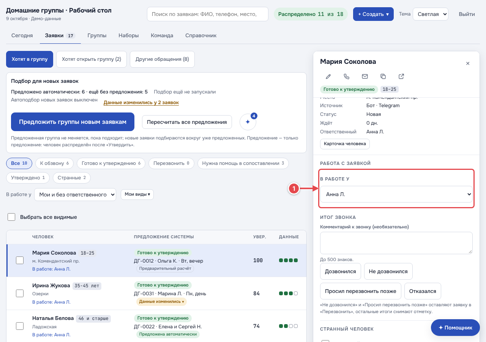

Прокрутите заявку справа вниз до блока **«Работа с заявкой»**.

1. В поле **«В работе у»** выберите **себя**.

Теперь человек ваш: другие распределители увидят, что им уже занимаются. И только теперь откроется **полный номер
телефона** — пока заявка чужая, видны лишь последние цифры.

### Шаг 3. Позвоните и расскажите о группе

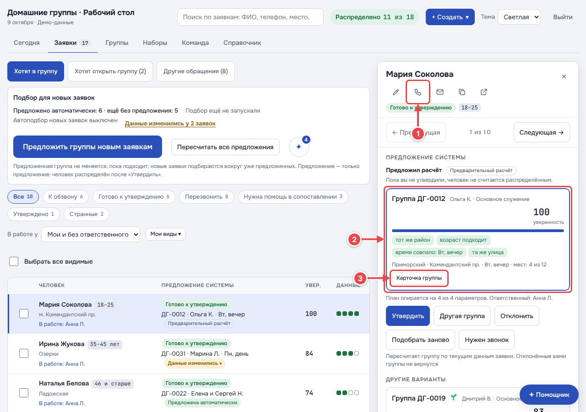

1. Нажмите **трубку** — на телефоне сразу наберётся номер. Работаете с компьютера — номер написан ниже, в блоке
   «Контакты», а значок с двумя листиками рядом с трубкой копирует его.
2. В рамке — **группа, которую предлагает система**: район, день, время, сколько свободных мест. Зелёные метки
   показывают, что совпало («тот же район», «время совпало»). Расскажите о ней человеку.
3. Нужны подробности (адрес, телефон ведущего, кто уже в группе) — нажмите **«Карточка группы»**. Подробнее — в
   [разделе 2](#2-как-посмотреть-данные-группы).

### Шаг 4. Запишите, чем закончился звонок

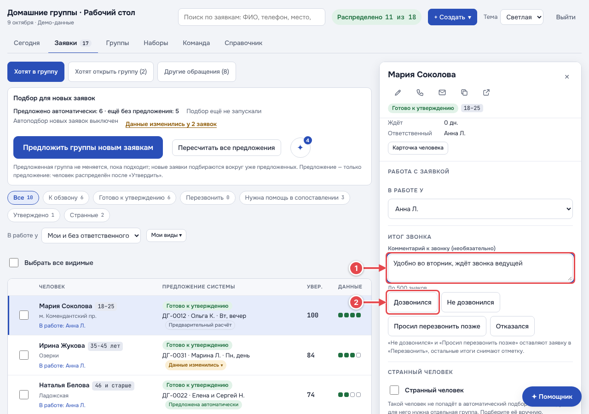

Прокрутите заявку вниз до **«Итог звонка»**.

1. Если есть что запомнить — напишите в **комментарий** (например: «удобно во вторник, ждёт звонка ведущей»).
2. Нажмите **«Дозвонился»**.

Не дозвонились — смотрите [раздел 4](#4-не-дозвонился).

### Шаг 5. Утвердите группу и переходите к следующему

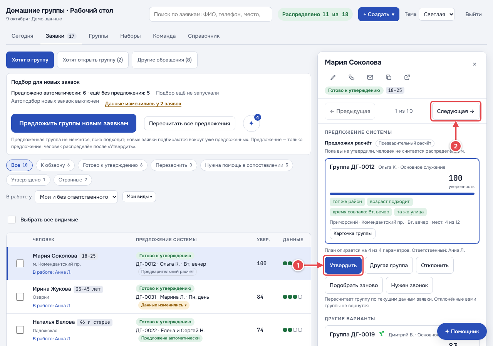

Прокрутите заявку обратно наверх.

1. Человек согласен на эту группу — нажмите **«Утвердить»**. Только после этого он считается распределённым: пока
   не нажали, группа — всего лишь предложение.
2. Нажмите **«Следующая →»** — откроется следующий человек из списка. Начните снова с шага 2.

> Удобный порядок обзвона: над списком нажмите кнопку **«К обзвону»** — там только те, кому пора звонить, — и
> идите по ним кнопкой «Следующая →».

---

## 2. Как посмотреть данные группы

### Из заявки человека

Нажмите **«Карточка группы»** под предложенной группой (шаг 3, пункт 3). Откроется окно:

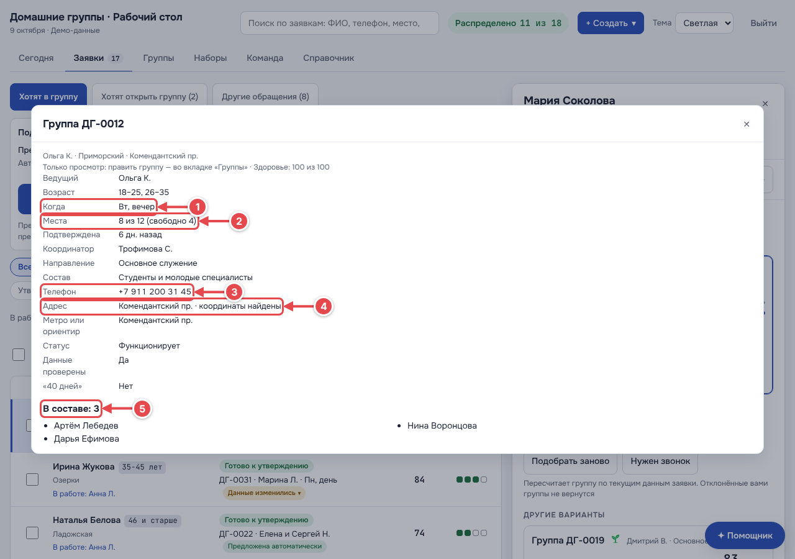

1. **Когда** — день и время встреч.
2. **Места** — сколько людей уже ходит и сколько мест всего; в скобках — сколько свободно.
3. **Телефон** ведущего.
4. **Адрес**.
5. **В составе** — кто уже ходит в группу.

Это окно только для просмотра: закрыть — крестик справа вверху.

### Все группы списком

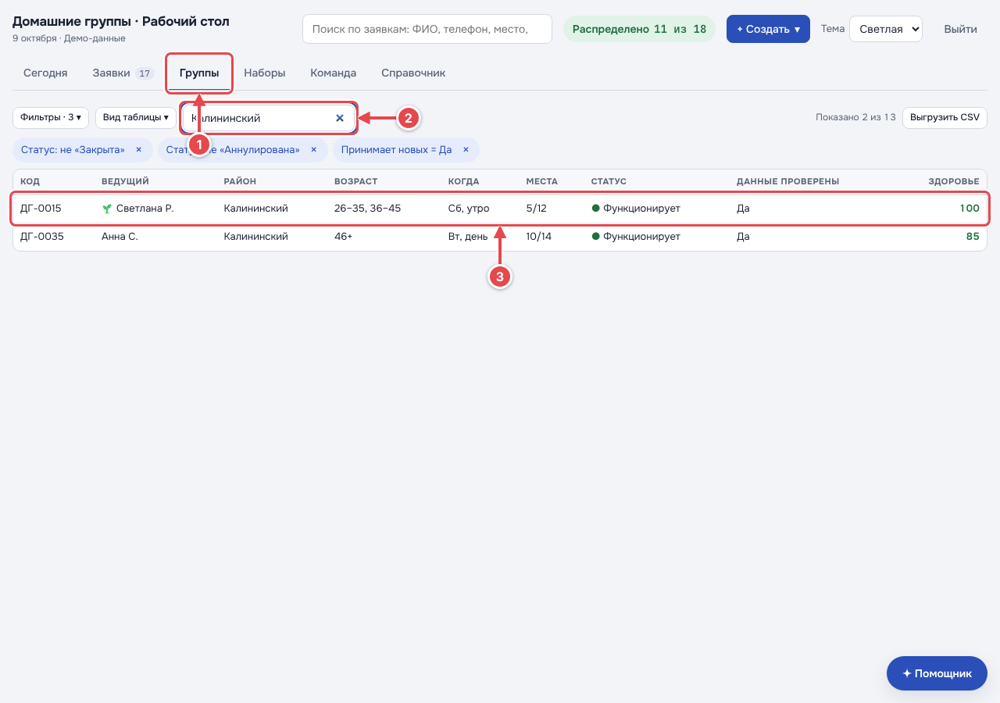

1. Откройте вкладку **«Группы»**. Здесь только группы, которые сейчас принимают людей.
2. Впишите в **поиск** район, метро, фамилию ведущего или код группы (например, «ДГ-0015»).
3. Нажмите на **строку группы** — справа откроется её карточка с теми же данными.

> Нет адреса и телефона? Это **камерная группа**: людей в неё не направляют, поэтому её контакты скрыты.

---

## 3. Группа не подходит человеку

Например, неудобный день или далеко ехать.

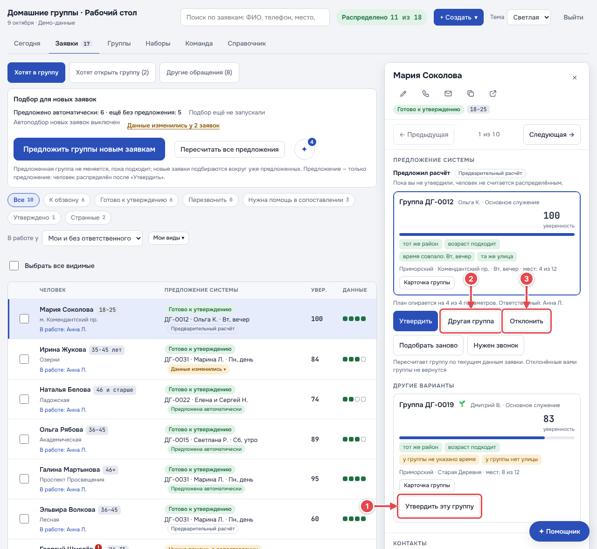

1. Посмотрите ниже, в **«Другие варианты»**: это запасные группы. Подходит — нажмите **«Утвердить эту группу»**.
2. Не подходят и они — нажмите **«Другая группа»** и выберите из всех групп (картинка ниже).
3. **«Отклонить»** — эта группа точно не подходит. Выберите причину (не подошло время, далеко…): больше её этому
   человеку не предложат. Потом нажмите **«Подобрать заново»** — система найдёт другую.

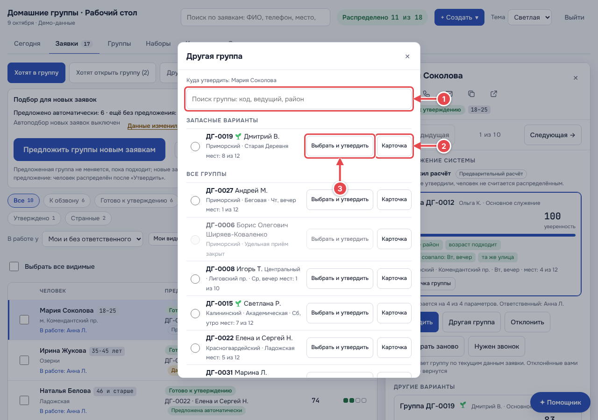

1. Впишите в **поиск** район, метро или фамилию ведущего.
2. **«Карточка»** — посмотреть группу подробнее.
3. Нашли нужную — **«Выбрать и утвердить»**. Человек сразу утверждён в эту группу.

Серая строка без кнопки — группа сейчас людей не принимает.

---

## 4. Не дозвонился

### Записать, что не дозвонились

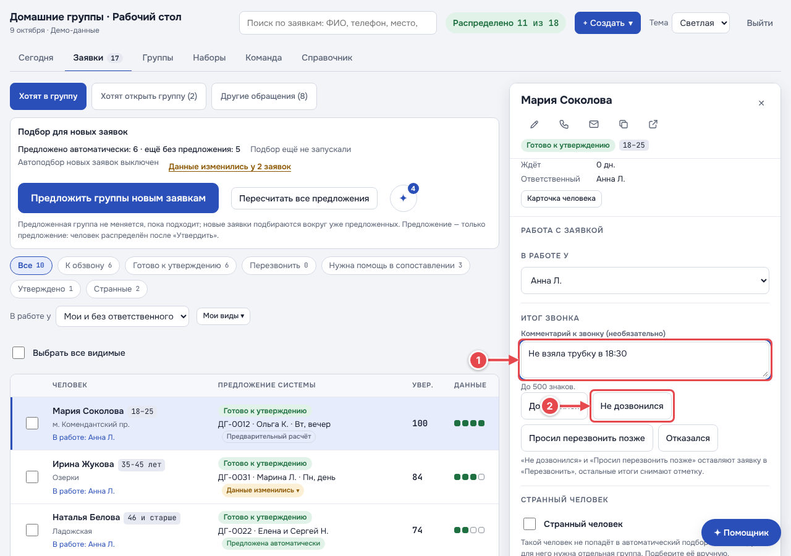

1. Напишите в **комментарий**, когда звонили (например, «не взяла трубку в 18:30»).
2. Нажмите **«Не дозвонился»**.

Человек попросил перезвонить позже — нажмите **«Просил перезвонить позже»**. В обоих случаях заявка переходит в
список **«Перезвонить»**.

### Перезвонить позже

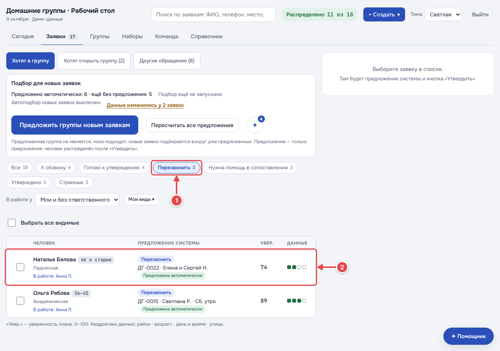

1. Над списком нажмите **«Перезвонить»** — здесь все, кому нужно позвонить ещё раз.
2. Нажмите на **человека** и звоните снова, как в [основном пути](#1-основной-путь-от-заявки-до-утвердить). Комментарий
   с прошлого звонка виден в заявке.

### Не отвечает совсем

Если звонили несколько раз в разные дни и человек так и не ответил, заявку закрывают. Сколько раз звонить, прежде
чем закрыть, скажет старший распределитель.

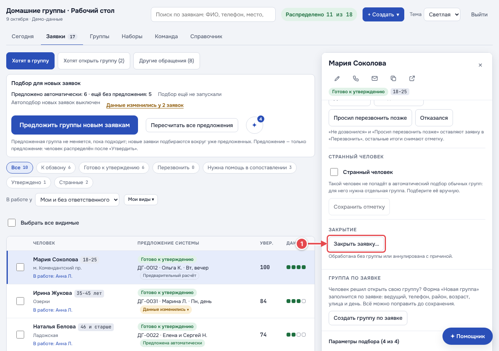

1. Прокрутите заявку вниз до блока **«Закрытие»** и нажмите **«Закрыть заявку…»**.

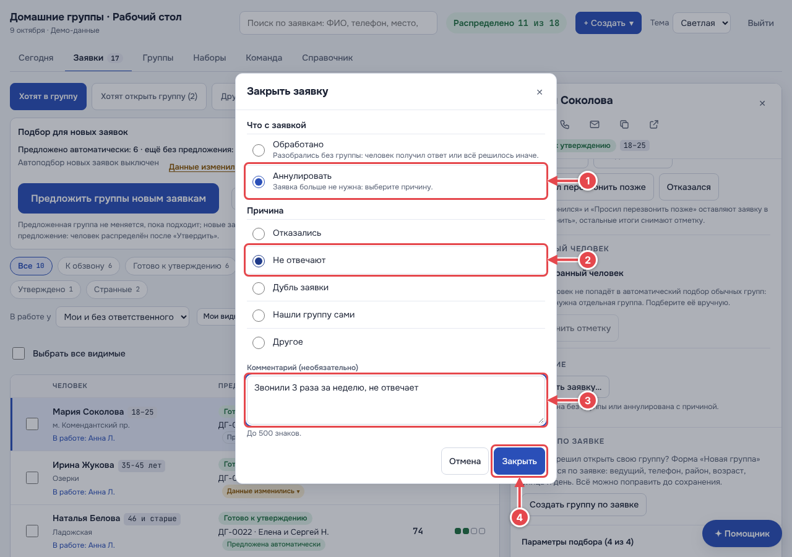

1. Выберите **«Аннулировать»**.
2. Причина — **«Не отвечают»**.
3. Напишите, сколько раз и когда звонили.
4. Нажмите **«Закрыть»**.

---

## 5. Человек отказался или уже нашёл группу

Сначала в **«Итог звонка»** нажмите **«Отказался»** (картинка в [разделе 4](#4-не-дозвонился), рядом с «Не
дозвонился»). Потом закройте заявку, как в разделе 4 («Закрыть заявку…» → «Аннулировать»), и выберите причину:

| Что случилось | Причина |
|---|---|
| Не хочет в группу | **Отказались** |
| Сам нашёл группу | **Нашли группу сами** |
| Эта же заявка уже есть (человек записался дважды) | **Дубль заявки** |
| Что-то другое | **Другое** — обязательно напишите комментарий |

Человеку ответили, но группа не нужна (например, задал вопрос) — выберите **«Обработано»** вместо «Аннулировать».

---

## 6. Исправить данные человека

Человек переехал, сменил удобные дни или в заявке ошибка — поправьте, и система подберёт группу заново.

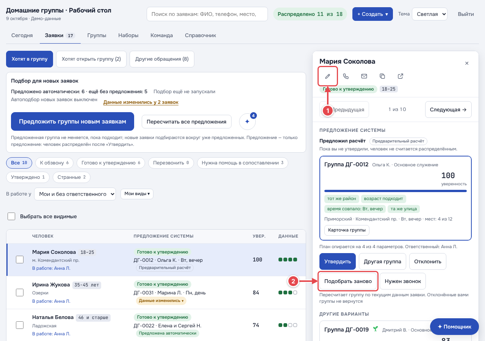

1. Нажмите **карандаш** под именем человека — откроется окно правки (картинка ниже).
2. После сохранения нажмите **«Подобрать заново»** — система найдёт группу по новым данным.

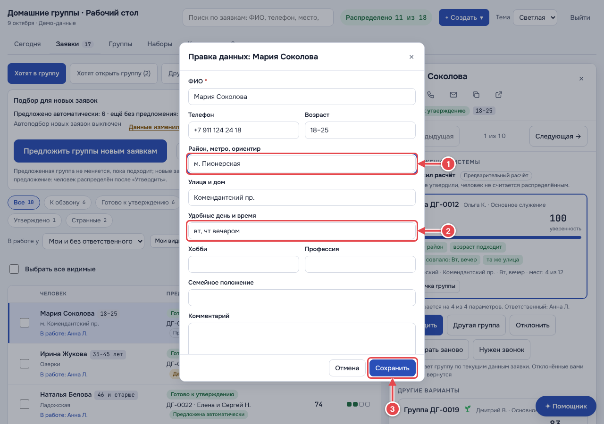

1. **Район, метро, ориентир** — где человеку удобно.
2. **Удобные день и время** — простыми словами, например «вт, чт вечером».
3. Нажмите **«Сохранить»**.

---

## 7. Группы на карте

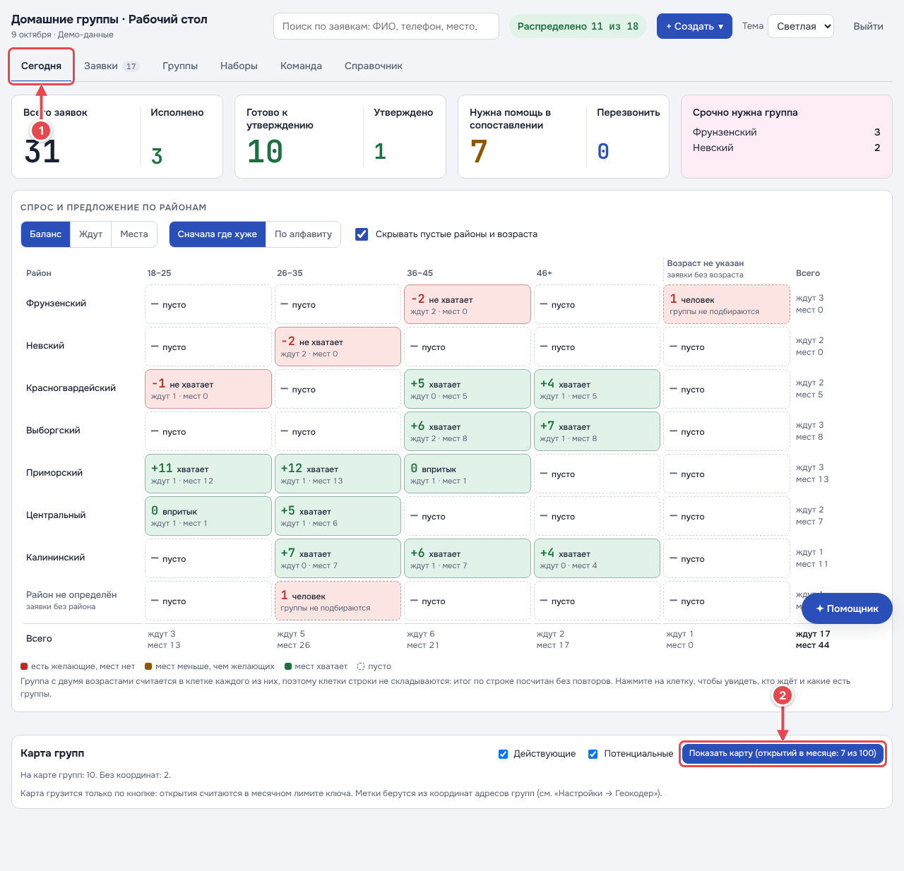

1. Откройте вкладку **«Сегодня»**.
2. Прокрутите в самый низ, до **«Карта групп»**, и нажмите **«Показать карту»**.

Открывайте карту, только когда она нужна: число открытий в месяц ограничено (оно написано на кнопке).

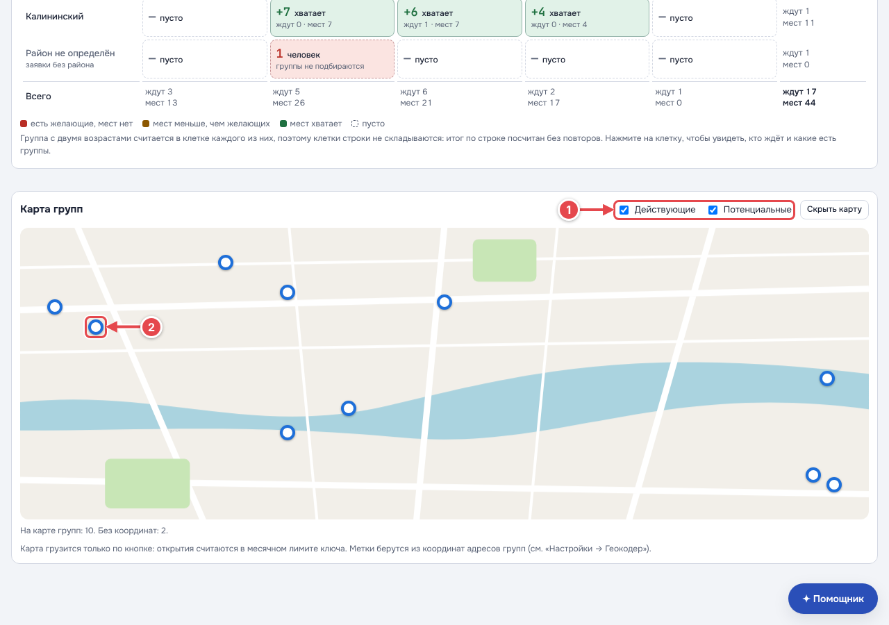

На сайте здесь настоящая Яндекс.Карта с улицами; на картинке она упрощена.

1. Галочки: **«Действующие»** — группы, которые уже собираются (синие точки), **«Потенциальные»** — которые только
   собираются открыться (оранжевые). Снимите галочку — точки этого вида пропадут.
2. Нажмите на **точку** — откроется карточка группы.

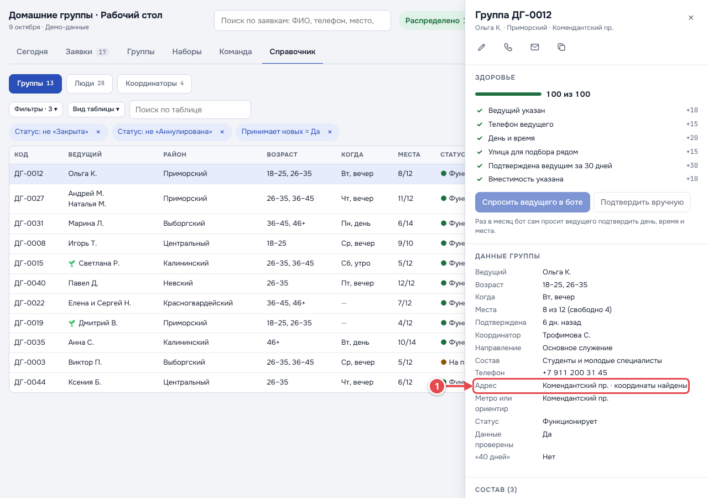

1. В карточке — **адрес**, а выше и ниже — день, время, места и телефон ведущего.

Закрыть карту — кнопка **«Скрыть карту»**.

---

## 8. Какие группы есть в районе

На вкладке **«Сегодня»** есть таблица: строки — районы, столбцы — возраст. Красная клетка — людей ждёт больше, чем
есть мест; зелёная — места есть.

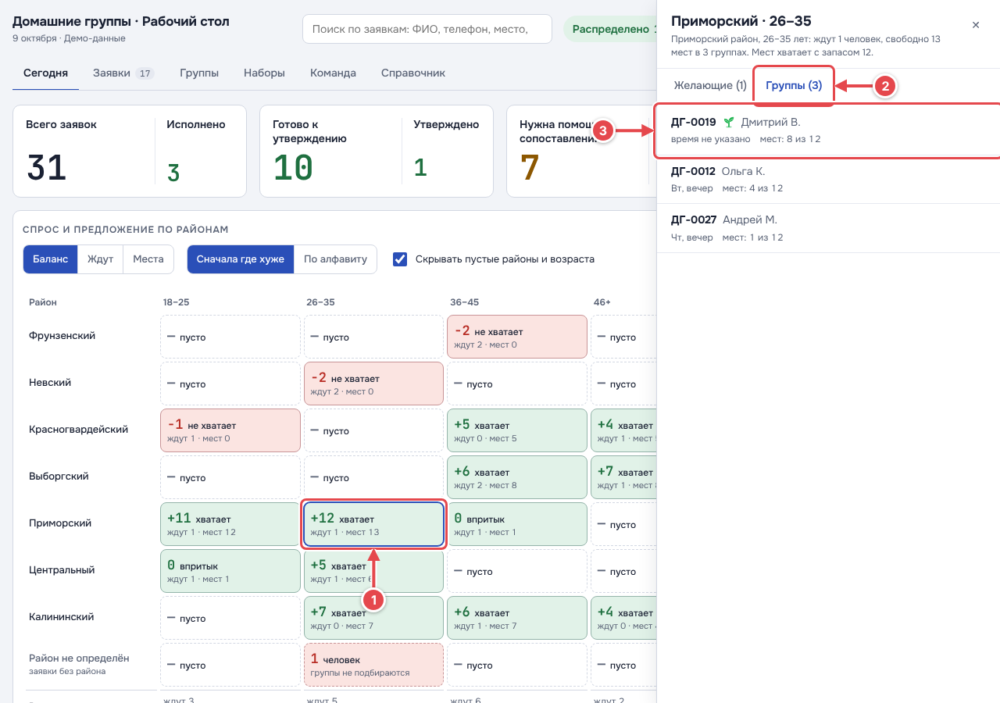

1. Нажмите на **клетку** нужного района и возраста — справа откроется окно.
2. Откройте вкладку **«Группы»** в этом окне.
3. Нажмите на **группу** — откроется её карточка.

Вкладка **«Желающие»** в том же окне — кто в этом районе ждёт группу.

---

## 9. Найти человека по фамилии или телефону

Человек сам перезвонил, и нужно быстро найти его заявку.

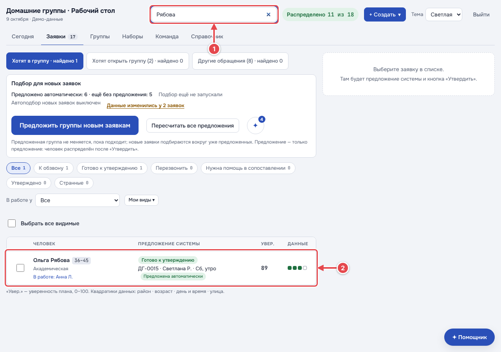

1. Впишите в **поиск** вверху фамилию, имя или часть телефона.
2. Нажмите на **человека** в списке.

Чтобы снова видеть весь список, сотрите текст в поиске крестиком.

---

## 10. Что значат кнопки над списком

Кнопки над списком заявок отбирают людей. Число на кнопке — сколько их.

| Кнопка | Кто там | Что делать |
|---|---|---|
| **Все** | Все люди в вашем списке | — |
| **К обзвону** | Кому пора звонить: группа подобрана или нужно перезвонить | Идите по ним кнопкой «Следующая →» |
| **Готово к утверждению** | Группа подобрана, осталось позвонить и утвердить | [Основной путь](#1-основной-путь-от-заявки-до-утвердить) |
| **Перезвонить** | Не дозвонились или просили перезвонить | [Раздел 4](#4-не-дозвонился) |
| **Нужна помощь в сопоставлении** | Система не нашла подходящую группу | Выберите сами через «Другая группа» ([раздел 3](#3-группа-не-подходит-человеку)) или спросите старшего распределителя |
| **Утверждено** | Уже распределены | Ничего, это для проверки |
| **Странные** | Люди с красным значком «!»: им нужна отдельная группа | Спросите старшего распределителя |

Поле **«В работе у»** под кнопками: **«Мои и без ответственного»** — обычный вид, менять не нужно.

---

## 11. Частые вопросы

**Нажал «Утвердить» не той группе.** Откройте заявку, нажмите «Другая группа» и выберите правильную. Если кнопок
нет — напишите старшему распределителю.

**Вместо телефона видны только последние цифры.** Заявка не ваша. Возьмите её себе: «В работе у» → своё имя
([шаг 2](#шаг-2-возьмите-человека-себе)).

**Сайт спрашивает «В группе нет мест. Утвердить всё равно?».** Группа заполнена. Лучше выберите другую; утверждайте
всё равно, только если договорились с ведущим.

**Кнопки «Помощник», «Предложить группы новым заявкам», «Пересчитать все предложения».** Распределителю они не
нужны, их можно не нажимать.

**Сайт пишет «Нет связи с сервером».** Ничего не сохранилось. Проверьте интернет и нажмите кнопку ещё раз.

---

Для разработчиков: картинки пересоздаёт `npm run shots:dist` в `web/home-groups` (экраны `dist-*` в
`scripts/shots.mjs`; карта на снимке — подмена Яндекс.Карт `FAKE_YMAPS`, список «Перезвонить» в демо —
`localStorage['hg.demo.callback']`, см. `src/fixtures/build.ts`).
