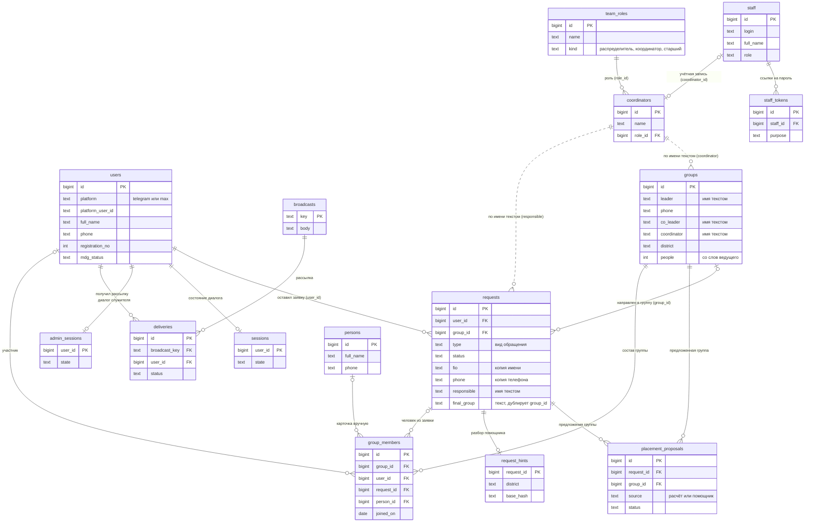

# Схема базы данных: что в ней есть, как связано и что можно упростить

Для владельца сервиса. Простыми словами, на аналогиях из 1С.

## Как это читать (аналогия с 1С)

| В 1С | В нашей базе |
| --- | --- |
| Справочник («Контрагенты», «Номенклатура») | таблица с постоянными записями: `users`, `groups`, `coordinators`, `persons` |
| Документ («Заказ покупателя») | таблица событий: `requests` (заявки), `broadcasts` (рассылки) |
| Реквизит типа «СправочникСсылка.Контрагенты» | колонка-**ссылка** (внешний ключ, FK): `requests.user_id` → `users.id` |
| Табличная часть документа | отдельная таблица со ссылкой на «шапку»: `group_members` (состав группы) |
| Регистр сведений | журналы и настройки: `audit_log`, `app_settings`, `system_errors` |
| «Строка вместо ссылки» (имя контрагента текстом) | **мягкая ссылка**: `requests.responsible` хранит имя координатора текстом, а не ссылкой на `coordinators` |

Настоящая ссылка даёт три вещи, которых нет у текста: нельзя сослаться на несуществующего, правка в одном месте меняет
везде, а база сама следит за целостностью. Мягкие ссылки (текстом) — главное, что стоит заменить.

В базе нет таблицы «сообщения»: бот не хранит переписку. Есть только рассылки (`broadcasts`, `deliveries`) и состояние
диалога (`sessions`).

## Схема связей

Сплошная линия — настоящая ссылка (внешний ключ). Пунктир — «мягкая» ссылка по имени текстом.

Без связей, отдельно стоят служебные таблицы: `audit_log` (журнал действий, ссылка на запись по типу и номеру без
внешнего ключа — так и должно быть для журнала), `system_errors` (журнал ошибок), `app_settings` (настройки «ключ →
значение»), `agent_prompts` (версии инструкций помощника), `campaign_days` (материалы дней кампании),
`schema_migrations` (какие миграции применены).

## Что за что отвечает

| Область | Таблицы |
| --- | --- |
| Люди и бот | `users` (участник кампании и его аккаунт в Telegram или MAX), `sessions` (на каком шаге анкеты человек), `admin_sessions` (то же у служителей) |
| Заявки и подбор | `requests`, `placement_proposals` (какую группу предложили), `request_hints` (что понял помощник) |
| Группы | `groups`, `group_members` (состав), `persons` (люди, внесённые вручную), `coordinators` (список координаторов), `team_roles` (роли команды) |
| Кампания «40 дней» | `campaign_days` (материал дня), `broadcasts` (рассылка), `deliveries` (кому дошло) |
| Доступ в интерфейс | `staff` (служители с логином), `staff_tokens` (ссылки на создание и сброс пароля) |
| Служебное | `audit_log`, `system_errors`, `app_settings`, `agent_prompts`, `schema_migrations` |

## Что лишнее, дублируется или должно быть ссылкой

От самого выгодного к самому дорогому.

**Сделано: роль координатора — ссылка на справочник ролей** (миграция `049`). Раньше `coordinators.role` была текстом,
а что роль значит, сервис угадывал по словам: распределителя для автоназначения искал по «распределител» в названии,
отборы после входа — по «старш» и «координатор». Теперь роли лежат в `team_roles`, у координатора ссылка `role_id`, а
смысл роли (`kind`: распределитель, координатор групп, старший координатор или без особых настроек) задаётся явно в
«Настройки → Роли команды». Переименование роли видно сразу у всех, роль с людьми удалить нельзя. Таблица церкви и
старый дашборд по-прежнему пишут роль словами — их название находит в справочнике (или заводит) функция `team_role_id`.

### 1. Координатор записан именем, а не ссылкой (выгодно и недорого)
`requests.responsible` и `groups.coordinator` — это имя текстом, хотя есть справочник `coordinators`. Следствия, на
которые мы уже наступили: при переименовании координатора приходится переписывать имя во всех заявках и группах
(сейчас это делает специальный код), а в церковной таблице встречаются имена, которых в справочнике нет.
**Что делать:** заменить на `coordinator_id`, ссылку на `coordinators`. Незнакомые имена из таблицы при переносе
получат новую запись в справочнике.

### 2. «Человек» хранится в трёх местах
Один и тот же человек может жить сразу в `users` (зарегистрирован в боте), в `requests` (имя, телефон, возраст и район
скопированы в самой заявке; у людей из церковной таблицы заявка — их единственная «карточка») и в `persons` (внесён
вручную). Из-за этого справочник «Люди» собирается из трёх источников, а у состава группы три колонки-ссылки
(`user_id`, `request_id`, `person_id`) вместо одной.
**Что делать:** один справочник людей `people`. `users` остаётся, но как аккаунты в мессенджерах, привязанные к человеку;
заявка и состав ссылаются на `person_id`. Тогда нет копий, дубли находятся сразу, а «Люди» — просто одна таблица.
Первый шаг уже сделан: состав ссылается на справочник, а не копирует. Полный переход — самая большая работа (затрагивает
бота, регистрацию, представления), делать её стоит отдельным этапом.

### 3. Ведущий записан текстом
`groups.leader`, `groups.phone`, `groups.co_leader`, `groups.co_leader_phone` и `users.leader_name` — имена и телефоны
текстом. Кто ведёт две группы, мы вычисляем по совпадению имени и телефона, то есть угадываем.
**Что делать:** ведущий — это человек: `leader_person_id` и `co_leader_person_id` на `people` (после пункта 2).
Тогда «кто ведёт несколько групп» и «ведущий состоит в своей группе» считаются точно.
**Первый шаг сделан:** у `groups` есть `leader_user_id` (миграция `030`) — ссылка на регистрацию ведущего. Заполняется при
разборе обращения «уже веду группу»: человека сверяют с ведущими групп по имени и телефону, и оператор подтверждает связь.
Имя и телефон ведущего в самой группе остаются, как записаны в таблице церкви.

### 4. Текстовые копии ссылки на группу
`requests.final_group` (например «ДГ-0012, Иван Петров») дублирует `requests.group_id`, а `requests.recommended` —
рекомендация текстом из церковной таблицы. Это следы переноса таблицы.
**Что делать:** после проверки убрать `final_group` (показывать группу по `group_id`), `recommended` оставить как
исторический текст или заменить ссылкой.

### 5. Параметры подбора лежат в двух местах
Что человек сказал о районе, возрасте и времени, хранится и в `users` (`location`, `age`, `schedule_raw`,
`address_raw`), и в `requests` (`place`, `age`, плюс правки координатора `manual_street`, `manual_schedule`). Где
правда — зависит от случая.
**Что делать:** «что человек сказал» в карточке человека, «что поправил координатор» в заявке — и всегда
показывать, откуда значение (это в интерфейсе уже есть).

### 6. `users` — три сущности в одной таблице (27 колонок)
Аккаунт в мессенджере (`platform`, `platform_user_id`, `chat_id`, `username`, `blocked_at`), анкета (`full_name`,
`church`, `mdg_status`, …) и регистрация кампании (`registration_no`, `kit_issued_at`, …).
**Что делать:** разделить на аккаунт, человека и регистрацию (идёт вместе с пунктом 2).

### 7. `staff` и `coordinators` — один человек
**Сделано** (миграция `048`): `staff.coordinator_id` — необязательная ссылка на человека из справочника команды; по ней
«мои заявки» определяются по входу.

### 8. `sessions` и `admin_sessions` — одинаковые по устройству
Обе: `user_id`, `state`, `data`, `updated_at`. Можно одной таблицей с видом («участник» или «служитель»). Мелочь,
косметика: делать только попутно.

### 9. Неиспользуемые поля
`placement_proposals.run_id`, `prompt_version`, `questions` заведены под будущего агента-подборщика и нигде не
используются (вопросы помощника теперь в `request_hints`). Их можно убрать или оставить до решения про агента.

### 10. Число участников группы живёт отдельно от состава
`groups.people` — «со слов ведущего», а состав в `group_members` плюс утверждённые заявки. Это две разные правды:
ведущий называет цифру, сервис считает по спискам. Оба числа полезны, ошибкой это не является; в интерфейсе их
стоит показывать рядом и подсвечивать расхождение.

### Что объединять не нужно
`request_hints` (разбор текста) и `placement_proposals` (какая группа предложена) — разные по смыслу.
`audit_log` и `system_errors` — разный срок хранения и разные читатели. `broadcasts`/`deliveries`/`campaign_days` —
нормальная цепочка «материал → рассылка → кому дошло».

## Порядок работ, если решите упрощать

1. **Пункт 1** (координатор ссылкой) и **пункт 4** (убрать текстовую копию группы): небольшие, самые безопасные,
   сразу убирают костыли.
2. **Пункты 2, 3, 6** вместе — единый справочник людей. Крупный этап: нужен план миграции данных, тесты на каждый
   вид записи и проверка бота. Делать по одному шагу с откатом.
3. **Пункты 5, 7, 8, 9** — по ходу, без отдельных этапов.
